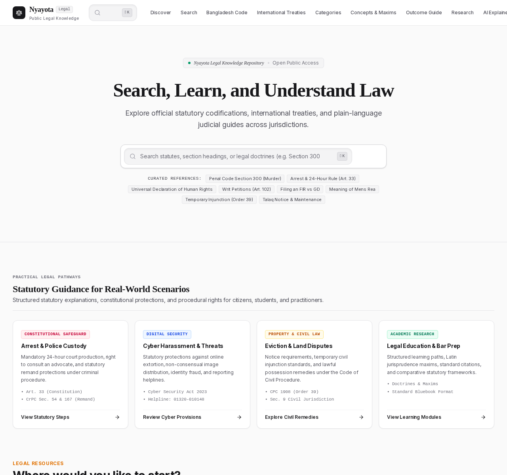
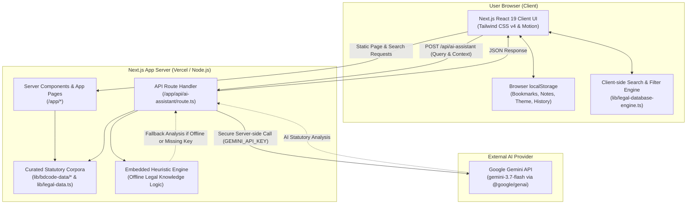

# Nyayota

<div align="center">

**Accessible, Transparent Legal Knowledge & Research Platform**

An open educational legal knowledge, statutory research, and navigation engine designed to make national and international codified laws searchable, comparable, and understandable.

[](https://nextjs.org/)
[](https://react.dev/)
[](https://www.typescriptlang.org/)
[](https://tailwindcss.com/)
[](https://www.npmjs.com/package/@google/genai)
[](LICENSE)
[](https://nyayota.vercel.app)

[**Live Web Application**](https://nyayota.vercel.app) • [**Source Repository**](https://github.com/afnan0356/nyayota) • [**Bangladesh Laws**](https://nyayota.vercel.app/bangladesh-laws) • [**International Treaties**](https://nyayota.vercel.app/international-laws) • [**AI Assistant**](https://nyayota.vercel.app/ai-assistant)

</div>

---



*Screenshot of the Nyayota website homepage (https://nyayota.vercel.app).*

---

## Table of Contents

- [Overview](#overview)
  - [The Problem We Address](#the-problem-we-address)
  - [Target Audience](#target-audience)
  - [Educational Scope & Non-Advocacy Notice](#educational-scope--non-advocacy-notice)
- [Feature Matrix](#feature-matrix)
- [Application Preview & Live Routes](#application-preview--live-routes)
- [Technology Stack](#technology-stack)
- [Architecture & Data Flow](#architecture--data-flow)
- [Quick Start Guide](#quick-start-guide)
  - [Prerequisites](#prerequisites)
  - [Installation](#installation)
  - [Local Development](#local-development)
  - [Production Build](#production-build)
- [Environment Variables](#environment-variables)
- [Repository Directory Structure](#repository-directory-structure)
- [Legal Content, Integrity & Verification](#legal-content-integrity--verification)
  - [Primary Sources & Authentication](#primary-sources--authentication)
  - [Editorial Boundaries & Translation Integrity](#editorial-boundaries--translation-integrity)
  - [Cryptographic Content Integrity](#cryptographic-content-integrity)
- [Privacy, Security & Responsible AI](#privacy-security--responsible-ai)
- [Development Commands & Scripts](#development-commands--scripts)
- [Development Roadmap](#development-roadmap)
- [Deployment & Hosting](#deployment--hosting)
- [Contributing](#contributing)
- [License & Intellectual Property](#license--intellectual-property)
- [Legal Disclaimer](#legal-disclaimer)

---

## Overview

**Nyayota** (derived from *Nyaya*, the Sanskrit and Bengali concept for justice, righteousness, and logical equity) is an open-access legal information and research web platform. It structures, organizes, and explains codified statutory legislation, constitutional jurisprudence, procedural codes, and international multilateral treaties.

Legal codes are frequently published across fragmented government gazettes, written in dense statutory prose, laden with archaic phrasing, or isolated in inaccessible PDF archives. Nyayota was built to make these primary legal texts transparent, searchable, and cross-referenced with plain-language explanations, bilingual terminology (English and Bengali), and educational procedural guidance.

### The Problem We Address

1. **Information Fragmentation:** Official legislation is dispersed across disparate gazette archives, historical amendments, and volume collections, complicating statutory research for non-specialists.
2. **Linguistic & Conceptual Barriers:** Legal maxims, Latin doctrines, and archaic statutory drafting often alienate ordinary citizens seeking to understand their basic legal rights.
3. **Absence of Unified Cross-Referencing:** Constitutional safeguards, criminal provisions, procedural remedies, and international human rights conventions are rarely presented side-by-side.
4. **Lack of Transparent Source Attribution:** Secondary summaries online often fail to cite the exact gazette publication, enactment year, or authoritative government portal.

### Target Audience

- **Citizens & Everyday Litigants:** Individuals seeking plain-language explanations of their basic legal rights, bail provisions, police procedures (FIR vs. General Diary), or family laws.
- **Law Students & Academics:** Researchers requiring structured statutory sections, comparative law analysis, and citation generation across Bluebook, OSCOLA, APA, and MLA styles.
- **Legal Practitioners & Researchers:** Advocates seeking quick, client-side access to section-by-section statutory text, bailability classifications, and cross-references.
- **Human Rights & Civil Society Organizations:** Advocates tracking international treaty obligations (UDHR, ICCPR, CAT, CEDAW) against domestic constitutional protections.

### Educational Scope & Non-Advocacy Notice

Nyayota is **strictly an educational and informational knowledge platform**. It is not a law firm, does not engage in the practice of law, and does not provide formal legal representation, attorney-client relationships, or judicial outcome guarantees.

---

## Feature Matrix

The following table reflects the actual implementation status of features verified within the repository codebase:

| Feature Area | Key Functionality | Source Reference | Implementation Status |
| :--- | :--- | :--- | :--- |
| **Bangladesh Statutory Catalog** | Section-by-section indexing of major Bangladesh statutes across British India, Pakistan, and Bangladesh eras with volume citations. | `/app/bangladesh-laws`, `/lib/bdcode-data/*` | **Implemented** |
| **International Law Database** | Multilateral treaties, UN conventions, and international humanitarian laws with official UNTS citations and depositary records. | `/app/international-laws`, `/lib/international-law-data.ts` | **Implemented** |
| **Statute Detail Engine** | Section navigation, bilingual Bengali/English headings, legislative history, "Explain Like I'm 15" plain summaries, and copy-section links. | `/app/law/[id]`, `/lib/legal-data.ts` | **Implemented** |
| **Global Full-Text Search** | Client-side search across statutes, categories, sections, Latin maxims, and keywords with recent search history caching. | `/components/GlobalSearch.tsx`, `/lib/legal-database-engine.ts` | **Implemented** |
| **Comparative Law Matrix** | Side-by-side comparative analysis of two statutes or international conventions with section diffing and concept alignment. | `/app/compare`, `/lib/legal-data.ts` | **Implemented** |
| **Legal Outcome Guide** | Practical citizen workflows covering arrest rights, bail, filing an FIR vs. GD, tenancy disputes, cheque dishonor, and labor claims. | `/app/legal-outcome-guide` | **Implemented** |
| **AI Legal Explainer** | Structured educational statutory queries powered by Google's `@google/genai` (`gemini-3.7-flash`) with prompt isolation. | `/app/api/ai-assistant/route.ts`, `/app/ai-assistant` | **Implemented** |
| **Heuristic Fallback Engine** | Embedded offline legal reasoning engine providing educational analyses when no `GEMINI_API_KEY` is present. | `/app/api/ai-assistant/route.ts` | **Implemented** |
| **Deterministic Nyayota AI Engine** | Source-grounded legal retrieval engine, 10-category intent classifier, IPC cross-jurisdiction disambiguation, and deterministic response generator. | `/lib/nyayota-ai/*`, `tests/*` | **Phase 2A, 3 & 4 Implemented (In-Development Core Engine)** |
| **Bilingual Legal Glossary** | Jurisprudential dictionary containing English legal terms, Bengali definitions, and Latin doctrines (*mens rea*, *habeas corpus*, etc.). | `/app/glossary`, `/components/GlossaryModal.tsx` | **Implemented** |
| **Standard Legal Citations** | One-click modal generating formatted citations in **Bluebook**, **OSCOLA**, **APA (7th)**, **MLA (9th)**, and **Chicago** standards. | `/components/CitationModal.tsx` | **Implemented** |
| **Private In-Browser Bookmarks** | Client-side bookmark drawer for saving laws and individual sections directly in `localStorage` without telemetry or accounts. | `/components/BookmarkDrawer.tsx`, `/lib/bookmarks.ts` | **Implemented** |
| **Source Transparency & Verification** | Modal displaying government source URLs, gazette references, official volumes, and SHA-256 verification hashes. | `/components/SourceVerificationModal.tsx` | **Implemented** |
| **Print & Export Formatter** | Clean, print-optimized document view with typographic styling for academic and professional reference. | `/components/PrintExportModal.tsx`, `/components/StatutoryPrintDocument.tsx` | **Implemented** |
| **Theme & Accessibility** | Dual theme (Dark/Light mode) with persistent preference detection, keyboard navigation, and responsive mobile layout. | `/components/ThemeProvider.tsx`, `/app/globals.css` | **Implemented** |
| **Research Workspace** | In-browser legal research scratchpad for attaching statutory provisions, drafting notes, and compiling references. | `/app/research` | **Implemented** |
| **Subordinate Legislation (SROs)** | Statutory Regulatory Orders, executive rules, and gazetted ministerial schedules under primary parent Acts. | `/app/roadmap` | *Planned (Q3–Q4 2026)* |
| **Judicial Precedent Indexing** | Direct cross-linking between statutory sections and reported Supreme Court (DLR, BLC, MLR) precedent summaries. | `/app/roadmap` | *Planned (2027)* |

---

## Application Preview & Live Routes

The deployed web application can be accessed at **[https://nyayota.vercel.app](https://nyayota.vercel.app)**. Major verified routes include:

| Route | Primary Purpose | Live URL |
| :--- | :--- | :--- |
| `/` | Landing page, featured statutes, quick search, and guided legal pathways. | [nyayota.vercel.app/](https://nyayota.vercel.app/) |
| `/bangladesh-laws` | Chronological and categorical catalog of Bangladesh Code enactments. | [nyayota.vercel.app/bangladesh-laws](https://nyayota.vercel.app/bangladesh-laws) |
| `/international-laws` | Multilateral conventions, human rights charters, and environmental treaties. | [nyayota.vercel.app/international-laws](https://nyayota.vercel.app/international-laws) |
| `/law/[id]` | Full statute reader (e.g. `/law/bd-penal-code-1860`, `/law/bd-constitution-1972`). | [nyayota.vercel.app/law/bd-penal-code-1860](https://nyayota.vercel.app/law/bd-penal-code-1860) |
| `/compare` | Side-by-side statutory and international convention comparison tool. | [nyayota.vercel.app/compare](https://nyayota.vercel.app/compare) |
| `/legal-outcome-guide` | Citizen step-by-step guidance on common legal situations and procedural remedies. | [nyayota.vercel.app/legal-outcome-guide](https://nyayota.vercel.app/legal-outcome-guide) |
| `/ai-assistant` | AI-assisted statutory question answering and plain-language query interface. | [nyayota.vercel.app/ai-assistant](https://nyayota.vercel.app/ai-assistant) |
| `/research` | Private client-side research workspace with notes and citation tools. | [nyayota.vercel.app/research](https://nyayota.vercel.app/research) |
| `/categories` | Categorical legal taxonomy covering 12 distinct branches of law. | [nyayota.vercel.app/categories](https://nyayota.vercel.app/categories) |
| `/glossary` | Searchable legal terminology and Latin maxims glossary with Bengali translations. | [nyayota.vercel.app/glossary](https://nyayota.vercel.app/glossary) |

> *Repository Screenshot:* The authentic full-resolution desktop screenshot of the live homepage is stored in [`public/images/nyayota-homepage.png`](public/images/nyayota-homepage.png).

---

## Technology Stack

Nyayota is constructed as a modern, type-safe Next.js application adhering to modern React paradigms:

| Layer / Domain | Technology | Version | Description & Role |
| :--- | :--- | :--- | :--- |
| **Application Framework** | [Next.js](https://nextjs.org/) | `^15.4.9` | App Router architecture, React Server Components (RSC), and API route handling. |
| **UI Library** | [React](https://react.dev/) | `^19.2.1` | Concurrent rendering, hooks, and component lifecycle management. |
| **Language** | [TypeScript](https://www.typescriptlang.org/) | `5.9.3` | End-to-end static typing across statutory schemas, API requests, and UI state. |
| **Styling & CSS** | [Tailwind CSS](https://tailwindcss.com/) | `4.1.11` | Utility-first styling utilizing `@tailwindcss/postcss` and native CSS cascade layers. |
| **Typography Plugin** | `@tailwindcss/typography` | `^0.5.19` | Structured prose formatting for long statutory provisions and legal articles. |
| **Motion & Transitions** | [motion](https://motion.dev/) | `^12.23.24` | Smooth layout transitions, modals, and spring physics via `motion/react`. |
| **Iconography** | [Lucide React](https://lucide.dev/) | `^0.553.0` | Accessible, tree-shakeable SVG icons for navigation and legal status badges. |
| **AI SDK** | [@google/genai](https://www.npmjs.com/package/@google/genai) | `^2.4.0` | Official Google Gen AI TypeScript SDK for Gemini API integration (`gemini-3.7-flash`). |
| **Class Utilities** | `clsx` & `tailwind-merge` | `^2.1.1` / `^3.3.1` | Conflict-free conditional className concatenation. |
| **Typography Styling** | `tw-animate-css` | `^1.4.0` | Tailwind-compatible CSS animation primitives. |
| **Code Quality & Linter** | [ESLint](https://eslint.org/) | `9.39.1` | Static analysis with `eslint-config-next` (`16.0.8`) enforcing clean React conventions. |

---

## Architecture & Data Flow

The platform relies on a static-first, highly scalable data architecture. Because statutory codes do not require high-frequency transactional updates, statutory data is stored directly in structured, typed TypeScript modules within the repository. This guarantees fast page loads, zero external database latency, predictable caching, and full offline search capability.



### Architectural Key Characteristics

1. **Zero External Database Dependency:** No Postgres, MySQL, or MongoDB database is required for core catalog browsing. This eliminates database connection failures, cold starts, and hosting overhead.
2. **Deterministic Statutory Storage:** Every enactment has an explicit identity, volume index, enactment date, section hierarchy, and cryptographic SHA-256 hash stored in version-controlled files under `/lib/bdcode-data/`.
3. **Graceful Degradation:** The AI Assistant API route (`/api/ai-assistant`) checks for `GEMINI_API_KEY`. If configured, it invokes `gemini-3.7-flash` with strict legal system instructions. If the key is absent or the external service fails, it automatically falls back to an internal heuristic legal analysis engine without breaking the user experience.
4. **Client-Side Privacy:** Research notes, bookmarks, and search queries are stored purely within the user's browser `localStorage`. No user telemetry or tracking identifiers are collected.
5. **Dual-Track AI Strategy (Production vs. Deterministic Grounding):** Production `/api/ai-assistant` leverages server-side Gemini (`gemini-3.7-flash`) with sliding-window rate limiting. In parallel, `/lib/nyayota-ai/` implements an in-development, 100% deterministic, zero-cost retrieval, intent classification, query routing, and source-grounded response generation engine (Phases 2A, 3 & 4) that operates strictly over indexed primary legislation without third-party LLM hallucination risks.

---

## Quick Start Guide

Follow these steps to run Nyayota locally on your machine.

### Prerequisites

- **Node.js:** Version `18.18.0` or higher (Node `20.x` or `22.x` recommended).
- **npm:** Version `9.x` or higher (or compatible package managers such as `pnpm` or `yarn`).
- **Git:** Installed on your system.

### Installation

1. **Clone the repository:**
   ```bash
   git clone https://github.com/afnan0356/nyayota.git
   cd nyayota
   ```

2. **Install project dependencies:**
   ```bash
   npm install
   ```

### Local Development

1. **Configure local environment variables:**
   Copy the example environment configuration:
   ```bash
   cp .env.example .env.local
   ```
   *(Optional)* Open `.env.local` and add your Google Gemini API key if you want to test live AI model responses:
   ```env
   GEMINI_API_KEY="your-gemini-api-key-here"
   APP_URL="http://localhost:3000"
   ```
   > *Note:* If you omit `GEMINI_API_KEY`, Nyayota will run normally and the AI Assistant will use its built-in local legal knowledge fallback engine.

2. **Launch the development server:**
   ```bash
   npm run dev
   ```

3. **Access the application:**
   Open your browser and navigate to:
   ```text
   http://localhost:3000
   ```

### Production Build

To verify that the application compiles cleanly for production:

```bash
# Build the production bundle
npm run build

# Start the production server
npm run start
```

---

## Environment Variables

Nyayota is architected to keep all credentials securely on the server side. **Never prefix secrets with `NEXT_PUBLIC_`**, as this exposes them to client-side JavaScript bundles.

| Variable | Purpose | Required? | Example / Default |
| :--- | :--- | :--- | :--- |
| `GEMINI_API_KEY` | Authenticates server-side calls from `/api/ai-assistant` to the Google Gemini API (`@google/genai`). | **Optional** *(Falls back to offline heuristic engine if omitted)* | `AIzaSy...` |
| `APP_URL` | Base public canonical URL of the application. Used for metadata and self-referential links. | **Optional** *(Defaults to localhost during local dev)* | `https://nyayota.vercel.app` |

### Security Guidelines for Environment Files

- Keep `.env.local` in `.gitignore` (already configured in this repository).
- Do not commit actual API keys, service account credentials, or secrets into version control.
- In hosting environments like Vercel, inject `GEMINI_API_KEY` directly via the project's Environment Variables dashboard.

---

## Repository Directory Structure

```text
nyayota/
├── .env.example                     # Sample template for environment variables
├── .eslintrc.json                   # ESLint configuration rules
├── .gitignore                       # Git ignore list (node_modules, .env*, .next)
├── eslint.config.mjs                # Modern flat ESLint configuration
├── metadata.json                    # Application metadata & platform capabilities
├── next.config.ts                   # Next.js compiler, image, and route configuration
├── package.json                     # Package dependencies, scripts, and engine specs
├── postcss.config.mjs               # PostCSS configuration with @tailwindcss/postcss
├── tsconfig.json                    # TypeScript compiler options and path aliases (@/*)
│
├── app/                             # Next.js App Router (pages and API routes)
│   ├── layout.tsx                   # Root HTML layout, font setup, theme initialization
│   ├── page.tsx                     # Landing page with hero, search, and featured laws
│   ├── globals.css                  # Global styles, Tailwind imports, and typography
│   │
│   ├── about/                       # Platform background, mission, and editorial standards
│   ├── accessibility/               # WCAG compliance statement & accessibility guide
│   ├── ai-assistant/                # Interactive AI Legal Explainer interface
│   ├── bangladesh-laws/             # Filterable chronological Bangladesh Code catalog
│   ├── categories/                  # 12 primary legal subject matter category indexes
│   ├── category/[slug]/             # Category-specific filtered law listings
│   ├── compare/                     # Side-by-side comparative statutory analysis engine
│   ├── concepts/                    # Jurisprudential principles, doctrines, and maxims
│   ├── contact/                     # Platform feedback and editorial inquiries
│   ├── disclaimer/                  # Legal terms of use and non-representation disclosure
│   ├── discover/                    # Exploratory thematic statute discovery
│   ├── glossary/                    # Searchable bilingual legal terms dictionary
│   ├── international-laws/          # Multilateral treaties and UN conventions catalog
│   ├── knowledge-paths/             # Guided legal learning modules
│   ├── law/[id]/                    # Full dynamic statute reader and section viewer
│   ├── legal-outcome-guide/         # Citizen step-by-step procedural outcome guides
│   ├── privacy/                     # Privacy policy (local-storage, zero telemetry)
│   ├── research/                    # Client-side legal research scratchpad workspace
│   ├── roadmap/                     # Public development and milestone roadmap
│   ├── search/                      # Advanced multi-parameter search page
│   ├── terms/                       # Terms of service and informational usage terms
│   │
│   └── api/
│       └── ai-assistant/
│           └── route.ts             # POST handler: Gemini 3.7 Flash API + offline engine
│
├── components/                      # Reusable React UI Components
│   ├── BookmarkDrawer.tsx           # Slide-out drawer for saved client-side bookmarks
│   ├── CitationModal.tsx            # Formatter for Bluebook, OSCOLA, APA, MLA, Chicago
│   ├── Footer.tsx                   # Global footer with navigation links & disclaimers
│   ├── GlobalSearch.tsx             # Modal search dialog with keyboard shortcut (Cmd/Ctrl+K)
│   ├── GlossaryModal.tsx            # Quick modal popover for legal terms & Latin maxims
│   ├── Header.tsx                   # Main navigation header with theme toggle & links
│   ├── LegalDefinitionPopover.tsx   # Inline tooltip definition for complex legal jargon
│   ├── MotionPrimitives.tsx         # Motion wrapper components for smooth animations
│   ├── PrintExportModal.tsx         # Document print preview and plain text export modal
│   ├── SourceTransparencyPanel.tsx  # Editorial breakdown of statutory origins & authenticity
│   ├── SourceVerificationModal.tsx  # Gazette details, authentic URLs, and checksums
│   ├── StatutoryHierarchyNav.tsx    # Table of contents navigation for parts/chapters/sections
│   ├── StatutoryPrintDocument.tsx   # Print-specific styled layout for offline documentation
│   └── ThemeProvider.tsx            # Client-side Dark/Light theme state provider
│
├── lib/                             # Core Business Logic, Data Schemas & Catalogs
│   ├── architecture.ts              # Universal data models for jurisdictions and acts
│   ├── bdcode-architecture.ts       # Bangladesh Code volumes (I–XXXVIII) and legislative eras
│   ├── bdcode-catalog.ts            # Central registry aggregating all Bangladesh laws
│   ├── bdcode-importer.ts           # Statutory ingestion helpers and validation utilities
│   ├── bdcode-search.ts             # Fuzzy and keyword search engine for Bangladesh acts
│   ├── bookmarks.ts                 # LocalStorage persistence helpers for saved sections
│   ├── international-law-architecture.ts # UN & multilateral treaty schemas
│   ├── international-law-data.ts    # Database of international conventions (UDHR, VCLT, ICCPR)
│   ├── legal-data.ts                # Master enriched statutory records and category mappings
│   ├── legal-database-engine.ts     # Multi-jurisdiction full-text indexing and query engine
│   ├── motion.ts                    # Framer Motion animation variant presets
│   ├── research.ts                  # Research workspace notes persistence in localStorage
│   ├── search-history.ts            # Recent search terms persistence helpers
│   ├── utils.ts                     # Utility functions (cn helper combining clsx + twMerge)
│   │
│   └── bdcode-data/                 # Modularized Bangladesh Statutory Datasets
│       ├── constitutional-criminal.ts   # Constitution, Penal Code, CrPC, Children Act, etc.
│       ├── civil-family-property.ts     # CPC, Contract Act, Muslim Family Laws, Property Act
│       ├── commercial-banking-tax.ts    # Companies Act, NI Act, Banking, Customs, Tax
│       └── environment-admin-local-cyber.ts # Cyber Security, Environment, RTI, Labor Act
│
├── hooks/                           # Custom React Hooks
│   └── useSearchHistory.ts          # Hook for retrieving and clearing local search history
│
└── public/                          # Static assets and repository media
    └── images/
        ├── nyayota-homepage.png     # Authentic desktop screenshot of the Nyayota homepage
        └── nyayota-homepage.jpg     # Source capture reference
```

---

## Legal Content, Integrity & Verification

Because legal information directly impacts citizens' rights, procedures, and understanding of the law, Nyayota enforces strict documentation and transparency standards.

### Primary Sources & Authentication

All statutory records included in Nyayota are grounded in authentic primary sources published by competent legislative bodies:

1. **Bangladesh Code & Legislation:**
   - **Primary Publisher:** Legislative and Parliamentary Affairs Division, Ministry of Law, Justice and Parliamentary Affairs, Government of the People's Republic of Bangladesh.
   - **Authoritative Portals:** [Laws of Bangladesh (bdlaws.minlaw.gov.bd)](http://bdlaws.minlaw.gov.bd) and [The Bangladesh Code (bdcode.gov.bd)](https://bdcode.gov.bd).
   - **Official Gazette:** *The Bangladesh Gazette Extraordinary*.
2. **International Conventions & Multilateral Treaties:**
   - **Primary Depositary:** Office of Legal Affairs, United Nations (*United Nations Treaty Collection — UNTS*).
   - **Treaty Series Reference:** Certified depositary texts published in the *United Nations Treaty Series (U.N.T.S.)*.

### Editorial Boundaries & Translation Integrity

To preserve legal accuracy, Nyayota explicitly differentiates between levels of content:

```text
[Authentic Primary Source Text] ──> Exact statutory language enacted by the legislature
             │
             ├──> [Official Translation]  ──> Official Gazette Bengali/English versions
             │
             ├──> [Editorial Summaries]   ──> Curated plain-language breakdowns ("Explain like I'm 15")
             │
             └──> [AI Interpretations]    ──> Machine-generated educational explanations
```

- **Official Statutory Text:** Exact verbatim transcriptions of codified sections, preserving section numbers, statutory headings, and original provisions.
- **Plain-Language Explanations:** Non-authoritative educational paraphrasing clearly delineated from the official statutory text to assist non-lawyers.
- **Translations:** Official Bengali titles (*দণ্ডবিধি*, *ফৌজদারি কার্যবিধি*) and provisions are drawn directly from official government gazettes or Ministry of Law publications.

### Cryptographic Content Integrity

Each major law in the repository includes metadata fields verifying its source authenticity:
- `checksumSha256`: Cryptographic hash of the baseline statutory text to detect accidental drift or corruption during repository updates.
- `lastVerifiedDate`: ISO timestamp recording when the record was last cross-referenced against the official government portal.
- `officialGazetteCitation`: Exact gazette publication date and enactment number.
- `integrityStatus`: Indicates whether the statute is `fully-verified`, `provisional`, or `curated-subset`.

Readers and maintainers can inspect these details at any time by clicking the **Source & Gazette Verification** button on any statute detail page.

---

## Privacy, Security & Responsible AI

### Zero Telemetry & Client-Side Privacy

- **No Remote User Database:** Nyayota does not operate a user database.
- **Local Storage:** Research notes, bookmarks, dark/light theme preferences, and search queries reside exclusively within the user's browser `window.localStorage`.
- **Zero Third-Party Ad Trackers:** The platform does not incorporate commercial tracking beacons or behavioral advertising scripts.

### Responsible AI Implementation

The AI Legal Explainer feature is designed with the following safeguards:

1. **Server-Side API Key Isolation:** Calls to the Gemini API are executed strictly within the Next.js server runtime (`/app/api/ai-assistant/route.ts`). The `GEMINI_API_KEY` is never transmitted to the client browser.
2. **Strict System Instructions:** The prompt forces the model into an educational, objective persona. It is instructed to reject requests for strategic litigation advice, refuse guarantees of court rulings, and mandate consultations with licensed advocates.
3. **Statutory Context Injection:** When a user queries from a specific law page, the exact statutory title, category, and section text are injected into the prompt context to prevent hallucination.
4. **Offline Deterministic Fallback:** In the absence of an API key, an internal heuristic rule engine provides educational statutory breakdowns without failing or exposing errors to the user.
5. **No Confidential Data Submission:** Users are explicitly advised on-screen not to input sensitive personal data, active case numbers, confidential documents, or personally identifiable information into the assistant.

---

## Development Commands & Scripts

The following scripts are defined in `package.json` and verified to execute in this codebase:

| Command | Action | Runtime Environment |
| :--- | :--- | :--- |
| `npm run dev` | Starts the Next.js local development server on port 3000 (`next dev -p 3000`). | Development |
| `npm run build` | Compiles the TypeScript application and produces the optimized `.next` production bundle. | Production / CI |
| `npm run start` | Boots the compiled Next.js production server. | Production |
| `npm run lint` | Runs ESLint (`eslint .`) across all `.ts`, `.tsx`, and `.mjs` source files. | Development / CI |
| `npm run clean` | Cleans cached build artifacts via `next clean`. | Utility |

---

## Development Roadmap

The development priorities below reflect the ongoing enhancement of Nyayota:

| Phase / Milestone | Objective | Target Scope | Status |
| :--- | :--- | :--- | :--- |
| **Milestone 1** | **Core Statutory Library** | Complete section-level digitization of high-impact statutes (Penal Code, CrPC, Constitution, Cyber Security, Labour Act, UDHR, VCLT). | **Completed** |
| **Milestone 2** | **Research & Comparison Tools** | Side-by-side statute comparison, Bluebook/OSCOLA citation export, and client-side research workspace. | **Completed** |
| **Milestone 3** | **Expanded Bangladesh Code (Vols I–XXXVIII)** | Progressive ingestion of civil, commercial, banking, property, and environmental acts. | **Active / In Progress** |
| **Milestone 4** | **Subordinate Legislation (SROs)** | Ingestion of statutory rules, government notifications, and schedules framed under parent Acts. | *Planned (Q3–Q4 2026)* |
| **Milestone 5** | **Offline PWA Capabilities** | Service worker caching to enable full-text offline reading of entire statutory codifications in low-connectivity areas. | *Planned (Q1 2027)* |
| **Milestone 6** | **Judicial Precedents & Case Citations** | Cross-referencing landmark Supreme Court of Bangladesh judgments with specific statutory sections. | *Planned (2027)* |

---

## Deployment & Hosting

Nyayota is optimized for cloud deployment on platforms that support modern Next.js App Router applications:

- **Production Deployment:** [Vercel](https://vercel.com)
- **Live URL:** [https://nyayota.vercel.app](https://nyayota.vercel.app)
- **Hosting Tier Requirements:** Node.js 18+ or 20+ runtime with support for dynamic API routes.
- **Continuous Deployment:** Pushes to the `main` branch of [afnan0356/nyayota](https://github.com/afnan0356/nyayota) trigger automated production builds.

To deploy your own fork to Vercel:

1. Import the repository into your Vercel dashboard.
2. In the Project Settings under **Environment Variables**, optionally add:
   - `GEMINI_API_KEY`: Your Google Gen AI API key.
   - `APP_URL`: Your custom domain (e.g. `https://your-domain.com`).
3. Deploy. The default build command (`npm run build`) and output directory will be automatically configured.

---

## Contributing

Contributions to Nyayota are welcomed, particularly in verifying statutory accuracy, expanding codified sections, improving accessibility, and adding bilingual translations.

### How to Contribute

1. **Fork the Repository:** Create a fork on GitHub at `https://github.com/afnan0356/nyayota`.
2. **Create a Feature Branch:**
   ```bash
   git checkout -b feature/amend-statute-data
   ```
3. **Adhere to Data Standards:**
   - Always verify statutory text against the official [Laws of Bangladesh](http://bdlaws.minlaw.gov.bd) or gazette records.
   - Include authentic volume references, act numbers, and enactment dates.
   - Maintain accurate bilingual titles (`title` in English, `titleBn` in Bengali).
   - Do not commit copyrighted commentary or proprietary legal textbook text.
4. **Validate Your Changes:**
   Run the test suite, linter, and production build before submitting:
   ```bash
   npm test        # or bun test
   npm run lint
   npm run build
   ```
5. **Submit a Pull Request:** Provide a descriptive pull request title detailing the exact statutes or components modified, along with primary source links.

---

## License & Intellectual Property

Nyayota is released under the **[MIT License](LICENSE)**.

- **Platform Source Code:** The application codebase, user interface, custom software components, and original styling in this repository are open source and licensed under the [MIT License](LICENSE). Copyright &copy; 2026 Md. Afnan. See the [`LICENSE`](LICENSE) file for the complete terms and conditions.
- **Primary Statutory Texts:** Codified legislation, Acts of Parliament, President's Orders, government gazette notifications, and international multilateral treaties reproduced herein are public government works and official statutory instruments. They are reproduced for educational, research, and non-commercial public knowledge purposes in accordance with public-domain legal principles and fair dealing provisions under international copyright conventions and national copyright laws.
- **Brand Protection & IP Audit:** For our detailed intellectual property evaluation, trademark safeguards, and proposed dual-licensing roadmap, see [`docs/LEGAL_AND_BRAND_PROTECTION_AUDIT.md`](docs/LEGAL_AND_BRAND_PROTECTION_AUDIT.md).

---

## Legal Disclaimer

> **IMPORTANT NOTICE:**  
> **Nyayota is an independent educational and research platform, not a law firm or a government agency.**
>
> 1. **No Legal Advice:** The materials, statutory texts, plain-language summaries, comparative analyses, and AI-generated outputs available on Nyayota are provided solely for general educational, academic, and informational purposes. They do not constitute formal legal advice, legal opinions, or professional legal representation.
> 2. **No Attorney-Client Relationship:** Using this website, browsing its statutory catalogs, or interacting with the AI Assistant does not create an attorney-client relationship between you and Nyayota or any of its contributors.
> 3. **Need for Independent Verification:** While every effort is made to maintain statutory fidelity and record authentic gazette references, laws are subject to legislative amendment, judicial reinterpretation, administrative notifications, and gazette repeals. Readers must cross-verify provisions against the official *Bangladesh Gazette*, the authoritative Ministry of Law portals, or certified depositary copies.
> 4. **AI Output Limitations:** AI-assisted explanations are generated via automated machine learning models (`@google/genai`). They may contain simplifications, omissions, or contextual inaccuracies and should never be relied upon for active court proceedings, contractual commitments, or strategic litigation decisions.
> 5. **Consult Qualified Counsel:** If you are facing an active legal dispute, criminal prosecution, civil litigation, or require formal legal counsel, you must consult a licensed advocate enrolled with the Bar Council or contact the National Legal Aid Services Organization (helpline **16430** in Bangladesh).
